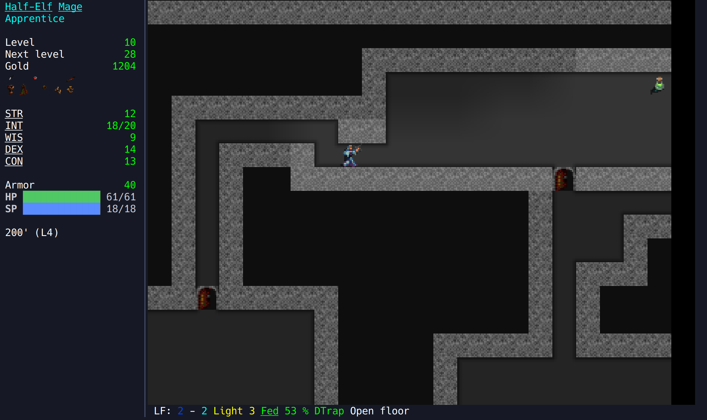
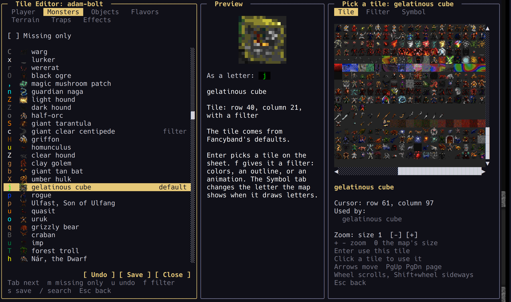
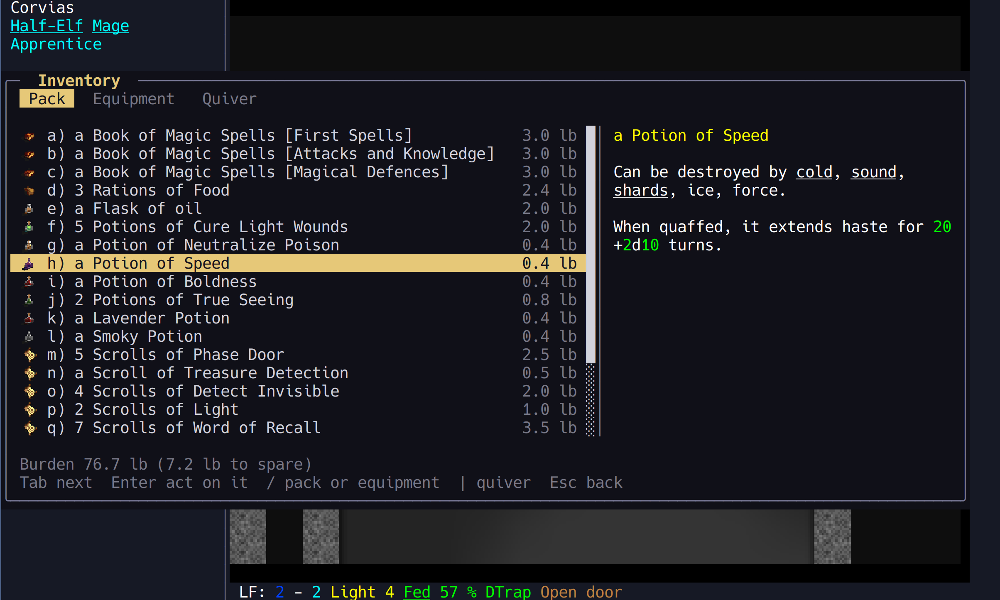
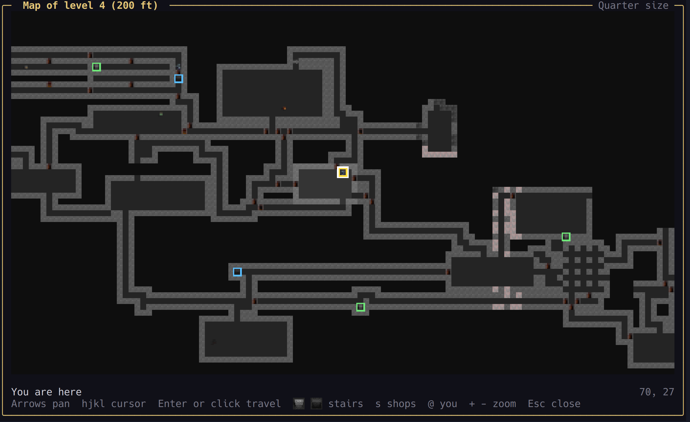

# Fancyband

Fancyband is a variant of [Angband](http://rephial.org/) 4.2.6 focused on UX. The gameplay is still vanilla Angband, but this project adds modern UI features and visual effects to the game, including the ability to use the game's graphic tilesets right in your terminal... even over SSH! Fancyband's UI lets you use the mouse everywhere, and replaces the game's text screens with modern ones. A built-in Tile Editor lets you change any tile and non-destructively apply colors, outlines, glows, and animations. For these early releases, I focused on Adam Bolt's tileset and used the tile editor to fill in the missing gaps for monsters and items that had no tile. All the new stuff can be turned off via the Options screen to the point where the game is nearly indistinguishable from vanilla.



Fancyband is at version 0.3.2 and runs only on Linux for now. Windows and macOS are planned.

## AI Use Disclosure

Fancyband is written with AI. Claude, Anthropic's AI model, writes most of the code, tests, and documentation, working in Claude Code. Every commit that Claude helped write ends with a `Co-Authored-By: Claude` line, so the history shows where AI was involved.

This is a passion project for me. I've been playing Angband for DECADES and I've always dreamed of a nice, user-friendly interface with nicer graphics, but never had the time or the ability to actualize that dream. The rise of AI coding and the current renaissance we are seeing in feature-rich TUI libraries and frameworks finally provided the conditions to make this a reality. I don't consider this to be a "vibe coded" project. While I'm not really a "coder", I understand software engineering concepts and used a structured, incremental methodology to direct Claude in the development process. I understand and empathize with the rage AI-written software often incites. It's ok. No one is making you use this software 🙂.

## Contents

- [Additions](#additions)
- [How it works](#how-it-works)
- [Build and play](#build-and-play)
- [Work on Fancyband](#work-on-fancyband)
- [Credits and licenses](#credits-and-licenses)

## Additions

### Tiles in your terminal

Fancyband prioritizes Angband's tilesets over the traditional ASCII graphics, while still remaining a terminal app. A new game starts in ASCII mode; pick a tileset on the Options screen, or start with `-tiles 2` for Adam Bolt's. It eschews the SDL and other vanilla ports entirely. Fancyband accomplishes this by separating Angband's game engine from its UI code, putting an API layer between them, and implementing a new frontend client utilizing the Limoni terminal UI and graphics library. For graphics, it has a drawing engine for the Kitty and Sixel terminal graphics protocols, plus iTerm2's own protocol, which is slower. To see tiles, you will need a terminal emulator which supports one of those protocols. So far, I've tested Fancyband in Konsole and iTerm2. With the Kitty protocol, it even stays fast and responsive over SSH! Other "fancy" features include:

- **Directional Tile flipping.** A monster's tile flips when it steps left and flips back when it steps right.
- **Smooth movement.** With tiles, your character and monsters slide from grid to grid instead of jumping. A key ends the slide at once.
- **Smooth map scrolling.** The map glides when you near its edge instead of jumping. In ASCII mode it moves a cell at a time. With Sixel, neither movement nor scrolling is smooth; use the Kitty protocol.
- **Each level has its own colors.** With tiles, the walls and the floor of each dungeon level get a random color of their own when you arrive. The town keeps its usual colors.
- **Light has soft edges.** An option smooths the steps where light meets dark, with blended corners, slanted cuts, or a dithered fade. It is off by default.
- **A MUCH better map.** Accurately shows the dungeon's layout and provides 3 zoom levels with tiles, or 2 in ASCII mode.
- **ASCII mode still works.** If your terminal can't show pictures, or you play inside tmux, Fancyband draws letters instead.

### A Tile Editor with filters

The Tile Editor lets you give anything a different tile, or give a tile to something that has none in its set. It works dynamically without editing the game's tilesheet bitmaps. You can make changes for one of your character saves, or for all of your saves. Starting the game from a source checkout with the `-dev` flag lets the Tile Editor change Fancyband's global tiles, which every player gets and which ship with every release built from that checkout.

Filters change how one thing's tile looks without changing the tileset. For example, you can turn one kind of orc blue and leave the others alone. Filters can:

- Flip a tile that faces left, so Directional Tile flipping turns it the right way.
- Shift the hue, saturation, and lightness, for all colors or only a range, such as reds.
- Adjust the opacity of a tile.
- Add an outline, inner glow, blur, a heat-haze waver, or sparkles.
- Animate between two sets of settings, so lava can ripple or a monster can pulsate.

In ASCII mode, the same editor changes the glyph and color of anything on the map.



### Modern UI panels with mouse support

Fancyband draws almost every UI panel itself. You can use the keyboard as in Angband, or click, double-click, and scroll with the mouse wheel. Every list scrolls with the arrow keys, Page Up and Page Down, and the wheel.



| UI Panel | What is new |
|---|---|
| Start menu and game menu | Continue, load, or make a character; open the options; turn the borg on or off; save and quit. Press Escape or F10 for the game menu. |
| Character creation | A step-by-step birth screen with a panel that explains each race, class, and stat. |
| Inventory, items, and spells | One screen for your pack, equipment, and quiver, with a description panel. Item and spell questions show only the choices that fit. |
| Shops | The store's goods and your pack side by side, with prices and descriptions. |
| Look and target | A list of everything you can see, nearest first, with a marker on the map and a description beside it. |
| Knowledge, character, messages, help | Tabs, search, and descriptions. Past messages can be filtered by kind. |
| Equipment comparison | A table of every item you own or could buy, against every resistance, ability, and stat. You can sort and filter it. |
| Level map | Pan, zoom, jump to stairs or shops, and click a spot to travel there. |
| Death screen | A tombstone, or a crown for a winner, and a quick start for the next character. |



### Descriptions on click or hover

Names the game has rules for are underlined: races, classes, stats, skills, abilities, elements, curses, and status effects. Click one, or rest the mouse on it, and a box explains what it does. The text comes from the game's own data files and manual.

### More on screen

When the window is large enough, a side panel shows the message log and the monsters you can see. A stats bar beside the map shows your gauges and the health of the monster you're fighting. Clicking the map walks there.

### The classic game is still there

Each new screen has a switch on the options screen that brings back Angband's own version. Your keymaps still work, the borg still plays, and a release keeps your saves in `~/.angband/Fancyband`, apart from any Angband install.

The full player guide is [docs/playing.md](docs/playing.md). It also ships as the README in each release.

## How it works

Fancyband is two programs:

- **The engine** is Angband's C code, changed so that it runs headless. It sends the game's state over a socket.
- **The client**, `fancyband`, is a Go program built on [Limoni](https://github.com/mmatis/limoni), a terminal UI library. It draws the game, takes your keys and clicks, and sends them back to the engine.

The protocol between them is described in [proto/README.md](proto/README.md). This architecture and protocol also mean that the community can build additional clients in other languages and frameworks without touching the original C code.

## Build and play

You need CMake, make, a C compiler, the ncurses development headers, Perl, Python 3, and Go 1.25 or newer.

1. Build and test everything from the repository root:

   ```
   scripts/check
   ```

2. Start the client:

   ```
   cd client
   go run ./cmd/fancyband
   ```

3. To show tiles from the start, add `-tiles 2` for Adam Bolt's set. You can also pick a set later in the options.

The window must be at least 80 columns by 24 rows. Press Ctrl+X or Ctrl+C to save and quit.

These client options are the ones you're most likely to need:

| Option | What it does |
|---|---|
| `-tiles N` | Uses tileset N, from 1 to 6, for this session. |
| `-graphics kitty` | Uses Kitty's image protocol when the client guesses wrong. `sixel` and `iterm2` are the other choices. |
| `-animate=false` | Keeps every animated tile still. |
| `-subwindows=false` | Turns off the side and bottom panels. |
| `-log-dir FOLDER` | Writes the logs somewhere other than `~/.angband/Fancyband`. |
| `-engine PATH` | Uses another engine. |

Options after `--` go to the engine. For example, `-- -n` starts with New character selected, and `-- -uName` picks a saved character.

## Work on Fancyband

### Organization

| Folder | What it holds |
|---|---|
| `engine/` | The engine's C source. A build puts it at `build/engine/game/fancyband`. The first commit, tagged `upstream-4.2.6`, is the unchanged Angband release. |
| `client/` | The Go client, `fancyband`. `netdump` prints what the engine sends, for debugging. |
| `proto/` | The protocol between the engine and the client, and test vectors that both sides check. |
| `scripts/` | Build, test, and release scripts. |
| `docs/` | The player guide, plans, and notes. |

### Test

`scripts/check` checks that the engine code includes no UI headers, builds the engine under `build/engine`, and runs every engine test. Then it builds, vets, and tests the Go client, including end-to-end tests that play the engine. It stops at the first failure. Add `--clean` to start from an empty build folder.

### Keep test games apart

A development build saves games in `build/engine/game/lib/save`, and keeps your monster memory and preferences in `~/.angband/Fancyband`. To keep a test game out of both, point the engine at scratch folders. Put the `-d` options before `-u` or `-n`:

```
mkdir -p /tmp/fbtest/user/archive /tmp/fbtest/save
go run ./cmd/fancyband -log-dir /tmp/fbtest -- \
    -duser=/tmp/fbtest/user -darchive=/tmp/fbtest/user/archive -dsave=/tmp/fbtest/save -n
```

### Change the global tiles

Run the client with `-dev`. The start menu then adds **Tile Editor (Global)**, which saves the tiles every player gets to `engine/lib/tiles/fancyband/`. Releases ship whatever that folder holds.

With `-dev`, a **New level colors** button also shows at the bottom of the stats bar while you are in the dungeon with tiles. If there is no stats bar, it sits on the Messages pane's title row. It rolls new colors for the level's walls and floor, and shows the numbers it rolled: each one's hue in degrees, tint strength, and lightness.

### Run the engine another way

The classic curses version still works:

```
build/engine/game/fancyband -mgcu
```

To see the raw stream the client gets, run the engine through `netdump`:

```
cd client && go build -o /tmp/netdump ./cmd/netdump
/tmp/netdump -screen -run ../build/engine/game/fancyband -n
```

Type keys and press Enter to send them. `<quit>` saves and exits.

### Make a release

```
scripts/dist --portable
```

This writes three files to `build/dist`:

- a tarball with `fancyband`, the engine as `bin/engine`, the game's `lib/` folder, the player guide as its README, and the licenses
- a source tarball
- their SHA-256 sums

`--portable` builds the engine in an Ubuntu 22.04 container with Docker, so it runs on glibc 2.34 and later. Without it, the engine needs the glibc of the machine that built it. The client is a static Go program and runs anywhere. A release saves characters in `~/.angband/Fancyband/save`, so a newer release keeps them.

## Credits and licenses

Fancyband is built on Angband 4.2.6, by the Angband developers and everyone who worked on its earlier versions. The tilesets are by their original artists: the original 8×8 tiles, Adam Bolt, David Gervais, Nomad, and Shockbolt.

Each part of Fancyband has its own license, and [LICENSE](LICENSE) says which applies where. In short:

- The game is under the GNU GPL version 2 or the Angband licence. [engine/FANCYBAND-CHANGES.md](engine/FANCYBAND-CHANGES.md) lists what Fancyband changed in it.
- The tilesets keep their own terms.
- Limoni is under the Apache 2.0 license. [docs/limoni-fork.md](docs/limoni-fork.md) says what Fancyband changed in it.
